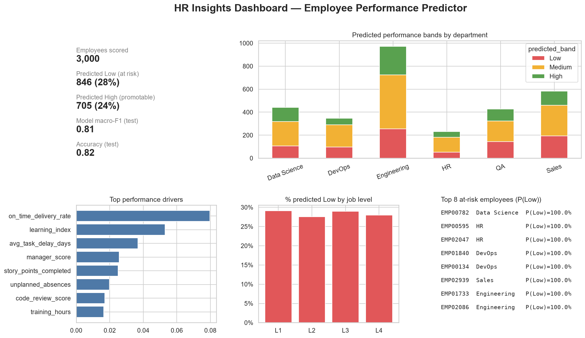
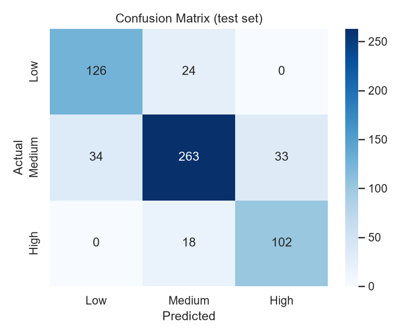
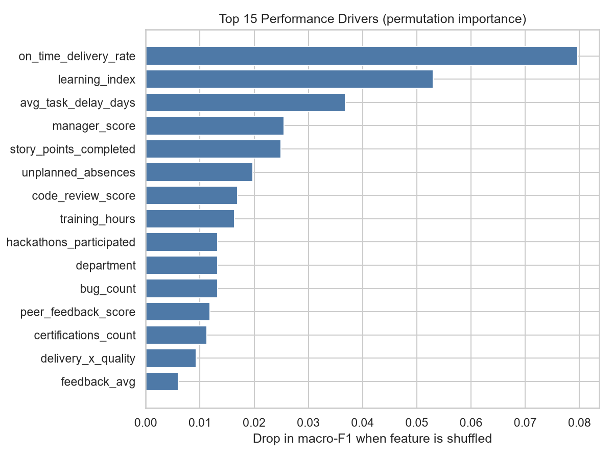
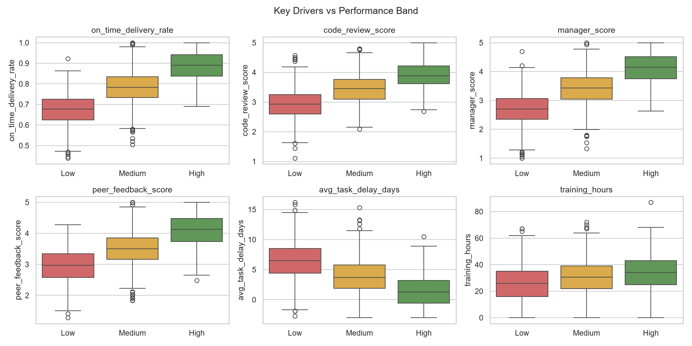

# 📊 Employee Performance Predictor using Data Analytics

An end-to-end people-analytics project that predicts an employee's **next-cycle performance band (Low / Medium / High)**, explains the **drivers** behind each prediction, audits the model for **fairness**, and converts results into **coaching actions** for HR and managers.

> ⚠️ **Data note:** Real HR data is confidential, so this project runs on a **synthetic dataset** produced by a "virtual company" simulator (`src/data_generator.py`). All results describe the simulation, not real employees.

---

## 1. Problem statement
Managers learn about low performance too late (at appraisal time). This project forecasts performance **1–2 months before the review**, so HR can intervene early with training, coaching, and workload changes, and can spot promotion-ready talent sooner.

## 2. Business value
| Stakeholder | How they use it |
|---|---|
| HR / L&D | Target training budgets at employees whose gaps are predicted to hurt performance |
| Managers | Get a one-page coaching brief per employee (drivers + 2 actions + review date) |
| Leadership | Department / level view of risk and promotion pipeline |
| Compliance | Fairness audit shows whether outcomes differ across groups |

## 3. Tech stack
Python · Pandas · NumPy · scikit-learn (Pipeline, ColumnTransformer, Logistic Regression, Random Forest, Gradient Boosting) · Matplotlib · Seaborn · Streamlit · Joblib

## 4. Architecture
```
 Synthetic HR data (27 features, 3,000 employees)
          │
          ▼
 Data quality checks  → range rules, duplicates, missing values
          │
          ▼
 EDA (6 charts) + Feature engineering (5 new features)
          │
          ▼
 sklearn Pipeline: impute → scale → one-hot  (sensitive cols removed)
          │
          ▼
 Train: Logistic Reg | Random Forest (grid-searched) | Gradient Boosting
          │   5-fold stratified CV, metric = macro-F1
          ▼
 Hold-out test evaluation → confusion matrix, per-class F1, ROC-AUC
          │
          ├─► Permutation importance (global drivers)
          ├─► Fairness audit (gender, age group, department, level)
          └─► Per-employee drivers → rule-based actions → one-pager (.md)
          ▼
 HR dashboard (PNG)  +  Streamlit app
```

## 4b. Folder structure
```
Employee-Performance-Predictor/
├── data/            synthetic dataset (employee_features.csv)
├── notebooks/       exploration notebook
├── src/             config, generator, quality, preprocessing, eda, train, evaluate,
│                    fairness, recommender, predict, dashboard
├── models/          saved best pipeline (employee_perf_model.pkl)
├── outputs/         metrics, predictions.csv, fairness report, employee one-pagers
├── images/          all charts / screenshots
├── tests/           unit tests
├── docs/            PROJECT_GUIDE.md (full guide: GitHub steps, interview prep, ...)
├── app.py           Streamlit HR app
├── main.py          runs the whole pipeline
└── requirements.txt
```

## 5. How to run
```bash
# 1. create & activate a virtual environment
python -m venv venv
source venv/bin/activate          # Mac/Linux
venv\Scripts\activate             # Windows

# 2. install
pip install -r requirements.txt

# 3. run the full pipeline (~1 minute)
python main.py

# 4. (optional) launch the app
streamlit run app.py

# 5. (optional) tests
pytest -q
```

## 6. Results (hold-out test set, 600 employees)
| Model | 5-fold CV macro-F1 |
|---|---|
| **Logistic Regression** (selected) | **0.808** |
| Random Forest (tuned) | 0.805 |
| Gradient Boosting | 0.801 |

| Metric | Value |
|---|---|
| Accuracy | 0.818 |
| Macro-F1 | 0.814 |
| Macro ROC-AUC | 0.941 |
| F1 Low / Medium / High | 0.813 / 0.828 / 0.800 |

**Top drivers (permutation importance):** on-time delivery rate, learning index (training + certifications + hackathons), average task delay, manager score, story points completed, unplanned absences.

**Honest interpretation**
- The three models score almost the same. That is expected: the simulator builds the true score from mostly linear relationships, so a simple linear model is enough. On real HR data, tree-based models might win. Re-run the comparison rather than assuming.
- ~81% accuracy reflects the noise level I put in the simulator. It is **not** a claim about real-world accuracy.
- Mistakes happen mostly between neighbouring bands (Low↔Medium, Medium↔High), which is what you'd expect for ordered categories.

## 7. Fairness audit
`gender` and `age` are **excluded from the model** and used only for auditing (`outputs/fairness_report.csv`).
- Gender: High-band disparate-impact ratio **0.88** (passes the 4/5ths rule). Groups with fewer than 30 test employees (e.g. "Other") are skipped because their statistics are unreliable.
- Age group (0.70), department (0.52) and job level (0.77) fall below 0.80 on the test split. The table also shows the *actual* High rate per group: the model's rates track the true rates, groups are small (56–189 employees), and the simulator deliberately gives Engineering / Data Science a small boost. So this mostly reflects base rates and sampling noise, but it would need investigation (larger samples, calibration by group) before any real-world use.

## 8. Screenshots
| | |
|---|---|
|  |  |
|  |  |

## 9. Limitations & responsible use
- Synthetic data; no real-world validation.
- Decision-support only: a human must review any prediction before it affects pay, promotion, or termination.
- `employee_features.csv` mixes all employees into train/test by row; real deployments should split by time (train on past cycles, test on the latest).
- Scoring the full company in `main.py` includes training rows, which is fine for the demo but overstates confidence (some employees show ~100% probability).

## 10. Future work
Real/public HR data (e.g. IBM HR Analytics) · SHAP explanations · attrition model · FastAPI service · MLflow tracking · drift monitoring (PSI) · time-based validation · calibration.

## License
MIT
